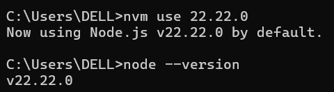
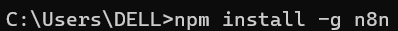
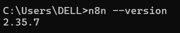
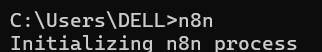
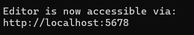
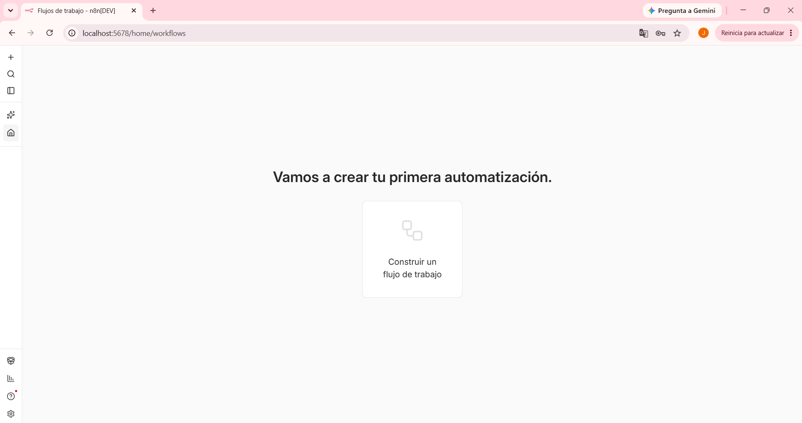

# n8n en local — instalación y arranque (T04)

n8n es la herramienta de automatización que usa el módulo E1 (lectura de correos). Esta guía explica cómo instalarlo y levantarlo en una computadora de desarrollo con Windows.

**Criterio de la tarea:** n8n abre en `http://localhost:5678`.

## Requisitos

- **Node.js 22**, la misma versión del proyecto (archivo `.nvmrc`). Se probó con la 22.22.0.
- Una terminal: CMD o PowerShell.

## 1. Comprobar la versión de Node

```bash
node -v
```

Debe empezar con `v22`. Si se usa **nvm** y hay otra versión activa, cambiar con `nvm use 22`.



## 2. Instalar n8n

```bash
npm install -g n8n
```

Tarda unos minutos. `-g` lo instala de forma global: queda disponible en cualquier carpeta y **no** se agrega al `package.json` del proyecto.



## 3. Comprobar la versión de n8n

```bash
n8n --version
```

Versión probada: **2.35.7**.



## 4. Levantar n8n

```bash
n8n
```

La terminal muestra `Initializing n8n process` y, cuando termina de arrancar, el mensaje `Editor is now accessible via: http://localhost:5678`.




## 5. Abrir el editor

Abrir `http://localhost:5678` en el navegador.

La primera vez, n8n pide crear una **cuenta de propietario** (correo y contraseña). Es una cuenta local: solo existe en esa computadora y no tiene relación con n8n Cloud. Después se inicia sesión con ella y se llega al panel de flujos de trabajo.



## 6. Detener n8n

En la terminal donde corre, presionar **Ctrl + C**. Cerrar la pestaña del navegador no lo detiene.

## Notas

- **Dónde guarda sus datos:** en la carpeta `.n8n` del usuario de Windows (`%USERPROFILE%\.n8n`, por ejemplo `C:\Users\<usuario>\.n8n`). Ahí quedan los flujos y las credenciales. Esa carpeta **no** se sube al repositorio. Los flujos se comparten exportándolos sin credenciales (T07).
- **Puerto ocupado:** si `5678` ya está en uso (otra terminal con n8n abierta), cerrar esa terminal o detener el proceso anterior antes de volver a ejecutar `n8n`.
- **Con Docker en vez de npm:** para que n8n llame al proyecto local se usa `http://host.docker.internal:3000` en lugar de `http://localhost:3000`.
